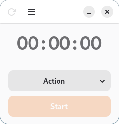
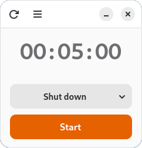
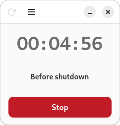

# stopw

## Screenshots

<p align="center">
  
  &nbsp;&nbsp;&nbsp;&nbsp;
  
  &nbsp;&nbsp;&nbsp;&nbsp;
  
</p>

A compact timer for GNOME that performs an action when the countdown ends.

stopw is written in Python using GTK 4 and libadwaita. It focuses on a
small interface, quick duration adjustments and a clear indication of
the scheduled action.

## Project status

stopw is under development.

The application currently runs from source as a standalone Python script.

The distribution goal is a ready-to-use Linux application that can be
launched from the desktop application menu without opening a terminal.
A downloadable executable distribution and a Flatpak version are planned.
The executable distribution format has not yet been selected.

Installation packages, a dedicated application icon and updated desktop
integration are not available yet.

## Features

Schedule one of the following actions:

- Power off the computer.
- Restart the computer.
- Suspend the computer.
- Show a notification, optionally with a sound.
- Run a custom shell command.

The interface includes:

- An editable hours/minutes/seconds display.
- Mouse-wheel and keyboard controls.
- A readable action label during the countdown.
- A Stop button to cancel the countdown.
- A reset button and a Delete-key shortcut.
- Optional restoration of the last started duration and selected action.
- Support for the system light/dark appearance preference.

## Run from source

From the repository root, run:

```bash
python3 stopw.py
```

## Credits and licensing

stopw originated from
[Time Switch](https://github.com/fsobolev/timeswitch).

The original Time Switch license is preserved in
[LICENSES/TimeSwitch-original.txt](LICENSES/TimeSwitch-original.txt).

See [CREDITS.md](CREDITS.md) and [LICENSING.md](LICENSING.md) for further
credits and licensing information.
