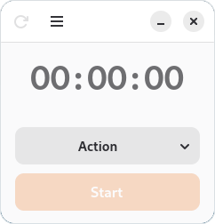
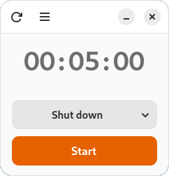
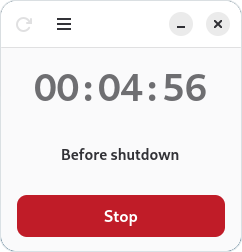

<p align="center">
  
</p>

# stopw

A compact timer for GNOME that performs an action when the countdown ends.

stopw is written in Python using GTK 4 and libadwaita. It focuses on a
small interface, quick duration adjustments and a clear indication of
the scheduled action.

## Screenshots

<p align="center">
  
  &nbsp;&nbsp;&nbsp;&nbsp;
  
  &nbsp;&nbsp;&nbsp;&nbsp;
  
</p>

## Project status

stopw is under active development.

The application can be run from source, installed locally with Meson,
or built and installed as a Flatpak.

The Flatpak manifest is intended for local builds. Publication to
Flathub is not yet configured.

## Features

Schedule one of the following actions:

- Power off the computer.
- Restart the computer.
- Suspend the computer.
- Show a notification, optionally with a sound.
- Run a custom shell command.

The interface includes:

- An editable hours/minutes/seconds display.
- Mouse-wheel and keyboard controls.
- A readable action label during the countdown.
- A Stop button to cancel the countdown.
- A reset button and a Delete-key shortcut.
- Optional restoration of the last started duration and selected action.
- Support for the system light/dark appearance preference.

## Origins and inspirations

The stopw repository began as a GitHub fork of
[Time Switch](https://github.com/fsobolev/timeswitch) by Fyodor Sobolev.

As a Time Switch user, I wanted to build my own compact timer with
scheduled actions. Time Switch inspired several stopw features, while
stopw's current implementation was developed separately using the
AI-assisted process described below.

The compact, focused interface approach was also inspired by
[Kooha](https://github.com/SeaDve/Kooha) by Dave Patrick.

stopw is maintained as a separate project. It is not an official
continuation of Time Switch and is not endorsed by its original author.

## Development approach

stopw is my project. I defined its purpose, features, interface, interaction
model and expected behaviour.

The application code was written with Gemini and Perplexity. GitHub-related
work, including repository documentation and workflow guidance, was supported
by ChatGPT and DeepSeek.

All design decisions, implementation review, testing and final integration
were made by me.

## Run from source

From the repository root, run:

```bash
python3 stopw.py
```

## Install with Meson

To build and install stopw for your user account, run:

```bash
meson setup build --prefix=$HOME/.local
meson compile -C build
meson install -C build
```

The application should then be available as **stopw** in the GNOME
application menu.

## Build and install with Flatpak

To build and install the Flatpak locally, run:

```bash
flatpak-builder --user --install --force-clean build-flatpak io.github.aealith2839.stopw.yml
```

Then launch it with:

```bash
flatpak run io.github.aealith2839.stopw
```

## Credits and licensing

The stopw application code is distributed under GPL-3.0-only.
See [COPYING](COPYING) for the complete license text.

See [CREDITS.md](CREDITS.md) for project history, development assistance
and resource attribution, and [LICENSING.md](LICENSING.md) for licensing
information.

The original Time Switch copyright and license notice is preserved in
[LICENSES/TimeSwitch-original.txt](LICENSES/TimeSwitch-original.txt)
to document the repository's origin.

sounds/complete.ogg originated from Interface sounds by Kenney
(https://kenney.nl/assets/interface-sounds)
License: Creative Commons CC0 1.0

The original application icon was created by Aealith2839.
License: Creative Commons CC0 1.0.
